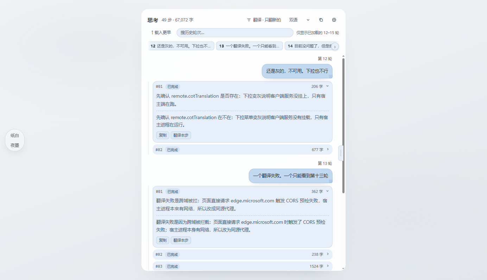
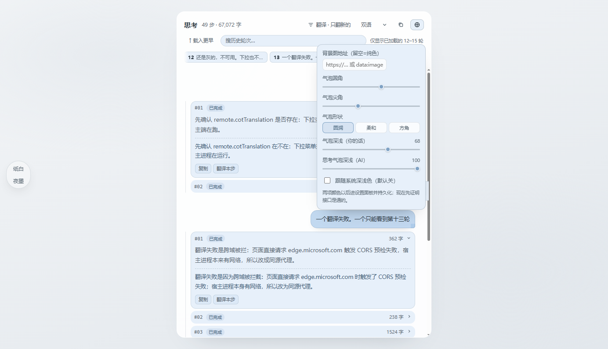

# Think Dock · 思考坞

> 把模型的“思考过程”从对话区搬进右侧边栏 —— 对话仍然干净，思考随时可读。

[](LICENSE)
[](https://github.com/deepseek-ai)

[English](README.md) · **简体中文**



## 它解决什么问题

DeepSeek Harness 里，模型的思考（reasoning）以一条可展开的「Think」行挂在对话里。展开它：

- 会把整段思考塞进对话流，滚动位置被推走；
- 翻过很多轮之后，想回头看某一轮的思考要一路往上翻；
- 英文/中文混杂的思考，读起来更费劲。

**Think Dock** 在右侧边栏注册一个新的标签页「思考」，把这些内容按 **轮 → 步骤** 重新排成一条时间线：可折叠、可复制、可翻译，而且**完全不改动对话区**。

## 功能

- **按轮/步的时间线**：每轮显示你的提问（右侧气泡）与该轮的思考步骤（左侧卡片），流式输出时实时追加。
- **只读不打扰**：不注入对话区、不改消息、不动你的输入框；关掉标签页就回到原样。
- **三种翻译档位**：`不翻译` / `只翻译新的`（默认，打开面板后新产生的思考才翻译）/ `全部翻译`；可开「双语对照」（原文在上、译文在下）。
- **翻译来源自动选择**：装了 DSH 自带的「思考翻译」插件时沿用它的 provider 与目标语言；没装时由插件自带的同源代理转发到微软 Edge 公共翻译（免费机翻，不上传你的会话）。
- **跟随 DSH 明暗主题**：用页面现有的 CSS 变量绘制，浅色/深色自动一致。
- **偏好会记住**：翻译档位、双语、展开状态等都存在本地 `localStorage`，重启不丢。
- **字符数、状态点、耗时**：每个步骤有小圆点表示进行中/完成/中断，右上角显示字数。

## 安装

要求：DeepSeek Harness **0.2.1-rc.2 或更新**（Web/桌面版均可，面板是渲染层插件）。

### 方式 A · 插件管理器（推荐）

1. 把本仓库克隆或有 zip 解压到任意目录；
2. 在 DSH 里让助手安装这个本地包，等价于：

```text
plugin_manager({ action: "install_bundle", target: "file:<本仓库绝对路径>" })
```

3. 安装完成后**重启 DSH**（宿主端要挂载翻译路由 `/think-dock/translate`）。

### 方式 B · 手动放进 profile

```powershell
$profile = "$env:USERPROFILE\.dsh\profiles\desktop"
# 1) 复制到 profile 的 node_modules
Copy-Item -Recurse .\dsh-think-dock "$profile\node_modules\dsh-think-dock"
# 2) 在 profile\package.json 的 "dsh": { "profile": { "bundles": [ ... ] } } 里加入 "dsh-think-dock"
# 3) 重启 DSH
```

## 使用

1. 打开任意会话，点右侧栏顶部的 **+**（或右上角「展开侧栏」）；
2. 选择 **思考**；
3. 继续对话 —— 新的思考会实时出现在坞里；点步骤标题折叠/展开，点「复制本步」拿到该步原文。



## 已知限制

- **只显示已加载的历史**：和 DSH 的对话一样，只有已经加载进页面的轮次才在坞里；更早的轮次需要在对话区往上滚动加载后才会出现（面板会提示）。
- **翻译需要出网**：走 Edge 公共翻译时要能访问 `edge.microsoft.com`；公司网络/离线环境请改用自带「思考翻译」插件提供的 provider。
- 翻译是**逐片**请求，单次文本上限 1200 字符，长步骤会分成多段。
- 面板是只读视图：不能从这里编辑或重发消息。

## 开发

没有构建步骤，浏览器半是原生 ESM，由 DSH 的模块加载器直接取用：

```
dsh-think-dock/
├─ package.json          # dsh.bundle.patch / dsh.client 声明
├─ cordis.patch.yml      # 宿主端那一行插件
├─ icon.svg
├─ lib/index.js          # 宿主半：同源翻译路由（可选）
├─ lib/client.js         # 浏览器半：右栏标签页 + 时间线 + 翻译 UI
└─ docs/                 # 截图与设计稿（docs/design/preview.html 可离线打开）
```

改完 `lib/*.js` 后重启 DSH 生效（浏览器半在页面加载时装配，宿主半不会热重载）。

## 许可

MIT © 2026 StarShine-XiuNing
